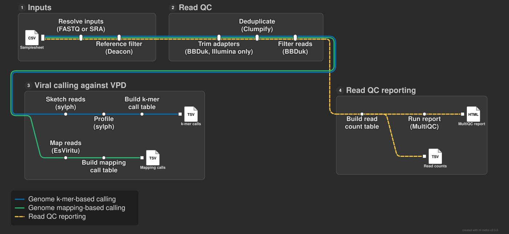

# Rapid Environmental MetaViromics (REMv)

REMV is a Nextflow pipeline for weekly viral surveillance from wastewater sequencing. It cleans the reads, then calls viruses two ways against the same reference database, EsViritu's Virus Pathogen Database (VPD):

- **Genome k-mer-based calling** (sylph) is fast and tuned for a very low false-positive rate.
- **Genome mapping-based calling** (EsViritu) maps every read, so it is slower but finds more low-abundance viruses.

Every result is a per-sample TSV that is written once and never rewritten, so a LIMS file watcher can import the tables as they appear.



>
> This pipeline is changing fast and will keep changing fast. Expect breaking changes at short notice. Params, published output paths, table columns and file names have all changed within a single week and will change again. There is no stability guarantee, no deprecation period and no migration path between revisions.
>
> If you depend on REMV's output, pin a commit and keep `05_run_summary/<run_id>.run_metadata.yaml` alongside your results — it records the tool versions, reference versions and every effective param for the run that produced them, which is the only reliable way to know what a given result means after the pipeline has moved on.
>
> The pipeline runs locally through a pixi environment on `linux-64`. Per-process containers and an OSPool profile are planned but not built yet.

## Quick start

You need [pixi](https://pixi.sh) and the references listed below.

```bash
git clone https://github.com/wkgardner/rapid-environmental-metagenomics.git
cd rapid-environmental-metagenomics
pixi install

cp conf/params_template.yaml my_run.yaml   # then fill in your paths
pixi run nextflow run . -params-file my_run.yaml
```

On a shared machine, add `-c conf/shared_host.config` to cap the run at 16 CPUs and 160 GB, and use `-work-dir` to keep the work directory somewhere with enough space.

## Samplesheet

The pipeline uses [NVD](https://github.com/dholab/nvd)'s samplesheet format, with one row per sample:

```csv
sample_id,srr,platform,fastq1,fastq2,fastq1_glob,fastq2_glob
site_a_week44,,illumina,/data/site_a_R1.fastq.gz,/data/site_a_R2.fastq.gz,,
site_b_week44,,illumina,,,/data/site_b_L*_R1_001.fastq.gz,/data/site_b_L*_R2_001.fastq.gz
site_c_week44,,ont,/data/site_c.fastq.gz,,,
public_sample,SRR33296246,illumina,,,,
archived_week12,,illumina,/archive/archived_week12.unaligned.cram,,,
```

- `platform` is required: `illumina` or `ont`.
- FASTQ paths and glob patterns must be absolute.
- Use the glob columns for samples split across lanes.
- **Unaligned CRAM** (for retrospective runs off archived data) goes in `fastq1`, recognised by
  its `.cram` suffix. One CRAM holds every lane and both mates of a sample, so leave `fastq2` and
  both glob columns empty. `samtools fastq` is streamed straight into the reference filter, as
  SRA runs are, so the expanded FASTQ never lands on disk. The pairing is read from the records'
  flags, since the samplesheet cannot say.

To build a samplesheet from a folder of bcl2fastq or BCL Convert files:

```bash
pixi run python bin/write_samplesheet_from_fastq_dir.py --fastq-dir /data/run --out samplesheet.csv
```

## References

| Param | What it is | How to get it |
| --- | --- | --- |
| `reference_filter_index` | Deacon index of the reads to remove (default mode) or keep | `scripts/build_host_depletion_index.sh` builds panhuman-1 + SILVA SSU/LSU, after you download the inputs listed at the top of the script |
| `esviritu_database` | Folder holding `virus_pathogen_database.{fna,fna.fai,mmi,all_metadata.tsv}` | The [EsViritu database](https://doi.org/10.5281/zenodo.17716199) |
| `vpd_lookup` | One row per VPD assembly. Not a pipeline param: it is only an input to the sylph reference build below | `bin/build_vpd_lookup.py` |
| `sylph_database` | VPD sketched at k31, c50 | `bin/write_sylph_genome_fastas.py`, then `sylph sketch` |

To build the last two from a VPD folder (`$VPD`):

```bash
pixi run python bin/build_vpd_lookup.py \
    --vpd-metadata $VPD/virus_pathogen_database.all_metadata.tsv --out vpd_lookup.tsv
pixi run python bin/write_sylph_genome_fastas.py \
    --vpd-fasta $VPD/virus_pathogen_database.fna \
    --vpd-metadata $VPD/virus_pathogen_database.all_metadata.tsv \
    --vpd-lookup vpd_lookup.tsv --min-fragment-length 31 \
    --out-dir sylph_genomes --genome-list sylph_genome_list.txt
pixi run sylph sketch --gl sylph_genome_list.txt -k 31 -c 50 -o vpd
```

> **Not reproducible from this repo yet:** our production runs use VPD 3.2.4 with a vector-only mask and a reference filter index that also includes Rfam 15.1 rRNA families. The build steps for the mask and for the Rfam addition are not scripted here, so the commands above give you an unmasked VPD and a filter index without Rfam.

If your filter index differs from the default, set `reference_filter_index_description` so that `run_metadata.yaml` describes it correctly. The template also sets `vpd_version` and `vpd_mask_version` for the same reason.

## Outputs

```
<outdir>/
├── 01_preprocessing/
│   ├── preprocessing_read_counts/
│   └── logs/
├── 02_genome_kmer_based_calling/
│   └── sylph_results/                 <sample_id>.sylph_profile.tsv
├── 03_genome_mapping_based_calling/
│   ├── esviritu_results/<sample_id>/  EsViritu's tables, consensus, log, params
│   ├── esviritu_final_bams/           <sample_id>.third.filt.sorted.bam{,.bai}, .third.reference.fa
│   └── esviritu_intermediates/<sample_id>/   rounds 1-2 and clustering tables (esviritu_keep: all)
├── 04_qc_report/                      <run_id>.multiqc_report.html
└── 05_run_summary/
    ├── sample_status/
    └── <run_id>.run_metadata.yaml
```

Each caller's own output is the result: sylph's profile and EsViritu's tables, consensus and alignments, published unchanged. REMV derives no call table of its own, so taxonomy joins and thresholds happen downstream.

REMV's own tables are named `<run_id>_<sample_id>.<table>.tsv`, and every row carries `run_id` and `sample_id`. An empty cell means null.

| Table | One row per | Key columns |
| --- | --- | --- |
| `preprocessing_read_counts` | sample | `raw_reads`, `reads_removed_by_reference_filter`, `reads_post_reference_filter`, `qc_duplicate_reads_removed`, `reads_post_qc` |
| `sample_status` | sample × step | `step`, `status` (`ok`, `no_reads_left`, `skipped_no_reads`, `no_detections`, `failed`, `skipped`) |

`run_metadata.yaml` records the tool and version behind each step, the reference versions and every effective param. Table and column names stay tool-neutral, so a tool can change without changing the tables.

### Reading the calls

- **The two callers disagree at the edges, by design.** EsViritu reports more species, many of them on a handful of reads. sylph can miss viruses present at low levels in large genomes.
- **The pipeline does not compare the callers**, or post-process either one. Compare `sylph_results` with `esviritu_results` downstream, for example in SQL in your LIMS. See [GLOSSARY.md](GLOSSARY.md) for the terms.
- **sylph does not name the VPD assembly.** Its `Genome_file` is the reference FASTA it was given, with `:` and `/` sanitised to `_` (`set:MF678311` becomes `set_MF678311`). Un-mangle it when joining to EsViritu's `Assembly`.
- **`vpd_subspecies` is not a strain call.** It names the nearest reference genome, not a variant detected in the sample.

## Configuration

Every tool setting has a default in [nextflow.config](nextflow.config) and can be overridden in your params YAML ([why](docs/adr/0001-determined-defaults-exposed-params.md)). The most common switches are:

| Param | Default | Effect |
| --- | --- | --- |
| `reference_filter_mode` | `deplete` | `deplete` removes reads matching the index; `extract` keeps only those reads |
| `skip_reference_filter` | `false` | Skips Deacon; the post-filter read count is left null |
| `trim_adapters` | `true` | BBDuk adapter trimming (Illumina only) |
| `dedup` | `true` | Clumpify exact-duplicate removal |
| `skip_read_filtering` | `false` | Skips the BBDuk quality, length and low-complexity filter |
| `skip_genome_kmer_based_calling` | `false` | Skips sylph; `sylph_database` is then not needed |
| `skip_genome_mapping_based_calling` | `false` | Skips EsViritu; `esviritu_database` is then not needed |
| `esviritu_keep` | `final` | Which alignments to publish. `none`: no BAMs. `final`: the round-3 BAM, its index and the reference it was mapped against (~180 MB/sample). `all`: plus rounds 1-2 and the clustering tables (~1 GB/sample) |

The sylph settings (k31, c50, minimum ANI 90) are the v1 defaults. The sylph database must be built at the same k-mer length and compression as the sample sketches.

## Tests

```bash
pixi run test-python      # bin/ scripts (pytest)
pixi run test-nf          # modules and the whole pipeline on synthetic data (nf-test)
pixi run make-test-data   # regenerate the synthetic data
```

## Credits and citation

REMV's mapping-based caller **is** [EsViritu](https://github.com/cmmr/EsViritu) (Tisza *et al.*, MIT licensed). EsViritu does the read mapping, the three rounds of reference clustering, the consensus calling and the per-virus tables; REMV publishes that output unchanged and derives no call table of its own. Both of REMV's callers work against EsViritu's Virus Pathogen Database (VPD), so the reference set behind every result here is EsViritu's work as well.

**If you use REMV, cite EsViritu:**

> Tisza MJ, Simar SR, Zorz JK, Javornik Cregeen SJ, Maresso AW. *EsViritu is a sensitive and specific profiler for viral pathogen detection and genome recovery in metagenomes.* <https://doi.org/10.64898/2026.09.29.755457>

**And cite the database version you ran against**, which `05_run_summary/<run_id>.run_metadata.yaml` records as `vpd_version` and `vpd_mask_version`:

> Virus Pathogen Database for EsViritu. Baylor College of Medicine. <https://doi.org/10.5281/zenodo.17716199>

Where the wastewater application is the point, the paper that introduced the method is worth citing too: Tisza MJ *et al.*, *Wastewater sequencing reveals community and variant dynamics of the collective human virome*, Nature Communications 14, 6878 (2023), <https://doi.org/10.1038/s41467-023-42064-1>.

### Other tools

[Deacon](https://github.com/bede/deacon), [BBTools](https://bbmap.org/), [sylph](https://github.com/bluenote-1577/sylph), [MultiQC](https://multiqc.info/), [sra-tools](https://github.com/ncbi/sra-tools), [sracha](https://github.com/rnabioco/sracha-rs) and [Nextflow](https://www.nextflow.io/). Exact versions are pinned in [pixi.toml](pixi.toml). Please cite these tools too if you use the pipeline.

## License

MIT
